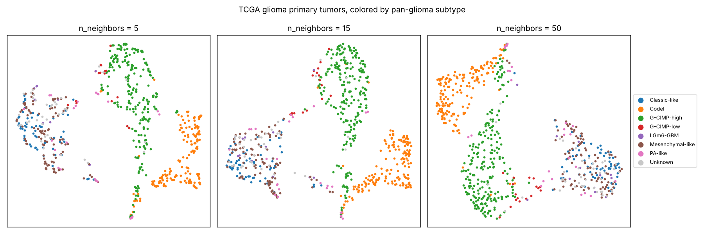

# glioma-umap
Demo UMAP analysis site built on the TCGA glioma dataset from UCSC Xena (2020)



## Data

670 primary tumors (516 lower-grade glioma, 154 glioblastoma) with RNA-seq from
[UCSC Xena](https://xenabrowser.net/):

| Source | Used for |
|---|---|
| `TCGA.GBMLGG.sampleMap/HiSeqV2` | Gene expression, log2(RSEM normalized count + 1) |
| `TCGA.GBMLGG.sampleMap/GBMLGG_clinicalMatrix` | Disease, grade, histology, age, gender |
| `survival/GBMLGG_survival.txt` | Overall survival ([TCGA-CDR](https://doi.org/10.1016/j.cell.2018.02.052)) |
| `TCGASubtype.20170308.tsv` (PanCanAtlas hub) | Pan-glioma subtype ([Ceccarelli et al. 2016](https://doi.org/10.1016/j.cell.2015.12.028)) |

IDH status is derived from the pan-glioma subtype: Codel, G-CIMP-high and
G-CIMP-low tumors are IDH-mutant; Classic-like, Mesenchymal-like, LGm6-GBM and
PA-like are IDH-wildtype.

## Pipeline

```sh
python -m venv .venv && . .venv/bin/activate
pip install -r requirements.txt
python pipeline/build.py --compare
```

1. Keep primary tumors (TCGA sample type `01`).
2. Select the 2,000 most variable genes and z-score each gene.
3. PCA to 50 components.
4. UMAP to 2D (`n_neighbors=15`, `min_dist=0.1`, `random_state=42`).

Downloads are cached in `data/`. The output, `public/data/umap.json`, has one
record per tumor with its coordinates and clinical fields, and is identical
across runs. `--compare` also writes `docs/n_neighbors.png`.

Small `n_neighbors` values emphasize local structure and split the IDH-wildtype
tumors into islands; larger values keep the global layout of the three major
groups (IDH-wildtype, IDH-mutant 1p/19q-codeleted, and G-CIMP-high).

## Web app

A Vite + React + TypeScript app that draws the embedding with
[deck.gl](https://deck.gl/). Color tumors by subtype, IDH status, disease or
grade; hover a tumor for its clinical fields, or a legend entry to highlight
that group.

```sh
npm install
npm run dev     # http://localhost:5173
npm run build   # static site in dist/
```
